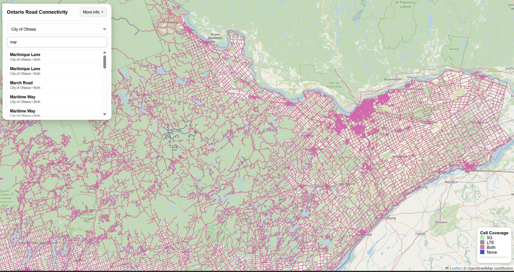

# Ontario Road Connectivity
<<<<<<< HEAD

=======

>>>>>>> 23a219f3cdba76443f5c3a72eef7827016d11387
An interactive web map showing Ontario road segments classified by cellular coverage: None, LTE, 5G, or Both.

## Overview

This project visualizes road connectivity across Ontario using a published ArcGIS Online Vector Tile Layer and Feature Layer. The map allows users to explore cellular coverage by road segment, search for road names, filter by jurisdiction, and inspect road attributes such as speed limit, pavement surface, and jurisdiction.

## Features

- Ontario-wide road coverage visualization
- Coverage categories:
  - None
  - LTE
  - 5G
  - Both
- Search by road name
- Filter search by jurisdiction
- Clickable road segments with popup details
- Interactive legend
- Expandable information card

## Data and Processing

The project was built using road and cellular coverage data processed in ArcGIS Pro.

### Workflow

1. Road and coverage data were cleaned and joined in ArcGIS Pro
2. Coverage classes were assigned to road segments
3. Geometry was simplified for web display
4. Data was published to ArcGIS Online as:
   - Vector Tile Layer for fast rendering
   - Feature Layer for search and popup queries
5. The web map was built with Leaflet, Esri Leaflet, and Esri Leaflet Vector

## Technologies Used

- HTML
- CSS
- JavaScript
- Leaflet
- Esri Leaflet
- Esri Leaflet Vector
- ArcGIS Pro
- ArcGIS Online

## Live Map

Add your GitHub Pages link here once deployed:

https://asage101.github.io/ontario-road-connectivity/

## Project Structure

```text
.
├── index.html
├── style.css
├── app.js
└── README.md
